<p align="center">
  
</p>

<h1 align="center">Paisa Planner</h1>

<p align="center"><b>Free, private money planner for India. Works offline — your data never leaves your phone.</b></p>

<p align="center">
  <a href="https://github.com/sauravsah/Paisa-Planner/raw/main/PaisaPlanner-v3.6.0-arm64.apk"></a>
</p>

<p align="center">
  For Android phones (Android 8 or newer). This is the right file for almost every phone.<br>
  <sub>Didn't work? <a href="https://github.com/sauravsah/Paisa-Planner/raw/main/PaisaPlanner-v3.6.0.apk">Try this one instead</a> (works on every phone, about 34 MB).</sub>
</p>

---

## How to install (2 minutes)

Paisa Planner is not on the Play Store yet, so you install it from this page. You download one file and open it. That's it.

**1. Tap the green Download button above.** Do this on your Android phone.

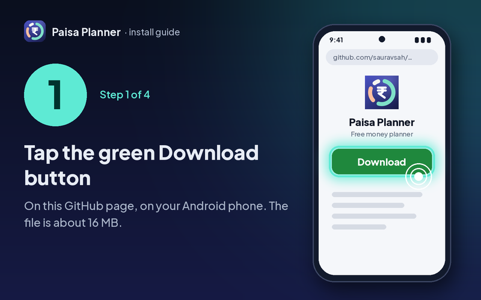

**2. Open the file you downloaded.** Tap it in your notifications, or open the Files app and look in Downloads.

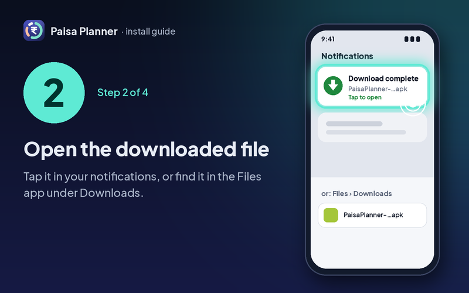

**3. If your phone says "For your security…", allow it once.** Tap **Settings**, turn on **Allow from this source**, then press back.

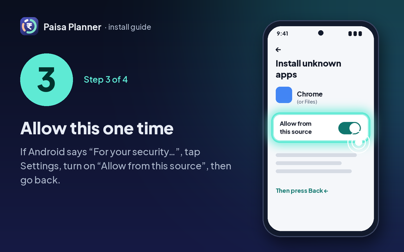

**4. Tap Install, then Open. Done!** Setup takes 2 minutes and asks for no permissions.

If Google Play Protect shows **"Scan app"** or **"Send for a security check"**, tap **Scan** (or **Install**). This version asks for no sensitive permissions, so it installs normally. You don't need to turn Play Protect off.

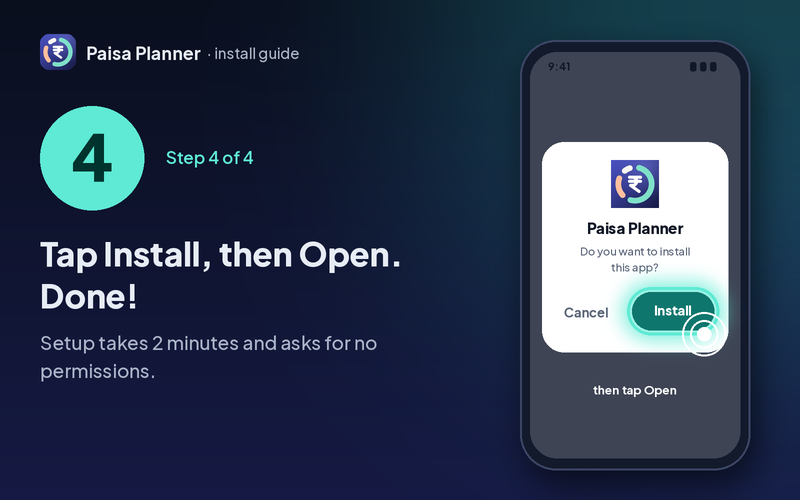

### Is this safe?

- The app has **no internet permission**. It can't send your data anywhere, even if it wanted to.
- This download asks for **no sensitive permissions**: no SMS, no notification access, no accessibility. That's why Play Protect lets it install.
- The download is the same file as on the [release page](https://github.com/sauravsah/Paisa-Planner/releases/tag/v3.6.0), signed with the same key as every version since v2.0.

### Updating later

When a new version comes out, come back to this page, download the new file and open it. Tap **Update** (or **Install**). It installs over the old app and **your data stays**. No need to uninstall first.

Settings › Check for updates opens the latest version.

<sub>Optional: the free <a href="https://github.com/ImranR98/Obtainium">Obtainium</a> app can watch <code>github.com/sauravsah/Paisa-Planner</code> and tell you when a new version is out.</sub>

---

## Add a bank SMS in 2 taps

You don't need to give the app SMS access. In your Messages app, **long-press the bank SMS › tap ⋮ (or Share) › Add to Paisa Planner**. You see the amount and the shop, check them, and tap Add. You can also copy any bank SMS or email and use **Paste a bank message** in the app.

---

## Want automatic SMS tracking? (SMS edition)

There is a second download, the **SMS edition**, that reads your bank SMS by itself. Before you pick it, here's the honest part:

- **Google blocks it by default.** In India, Google Play Protect blocks apps that read SMS when they're installed from a browser ("App blocked to protect your device"). Nothing in the app can get around that.
- So the SMS edition only works if you're comfortable **pausing Play Protect for a minute while you install**, and **allowing "restricted settings"** once for this app (Android 13 and newer). Turn Play Protect back on right after.
- You probably don't need it: the normal version already adds a bank SMS in 2 taps (select the text › **Add to Paisa Planner**).

Both editions are the same app with the same signing key. You can install one over the other and **your data stays**. If you switch back to the normal version, SMS auto-tracking stops but everything you saved is kept.

**1. Pause Play Protect while you install.** Play Store › your profile photo › Play Protect › settings (gear) › turn off **Scan apps with Play Protect**.

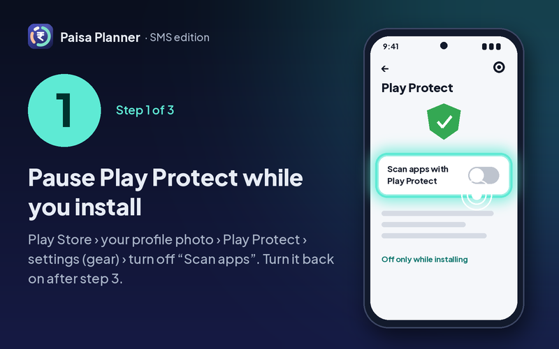

**2. Install the SMS edition, then allow restricted settings.** Download [PaisaPlanner-v3.6.0-SMS-edition-arm64.apk](https://github.com/sauravsah/Paisa-Planner/raw/main/PaisaPlanner-v3.6.0-SMS-edition-arm64.apk) (about 16 MB; if it doesn't install, [the universal one](https://github.com/sauravsah/Paisa-Planner/raw/main/PaisaPlanner-v3.6.0-SMS-edition.apk), about 35 MB) and install it. Then long-press the app icon › **App info** › **⋮** (top right) › **Allow restricted settings**, and confirm with your PIN or fingerprint. On Samsung and Xiaomi the ⋮ item can be somewhere else: if you don't see it, open **Permissions › SMS** first, tap the greyed option, then come back.

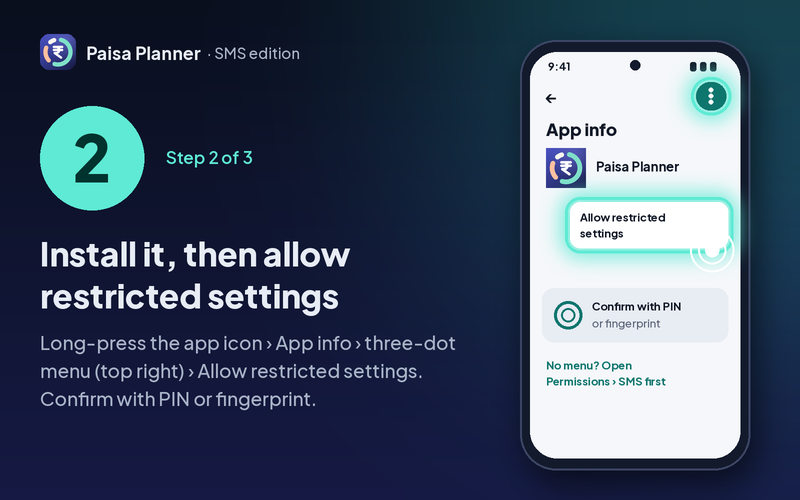

**3. Allow SMS, then turn Play Protect back on.** In App info › **Permissions › SMS › Allow**. Or just open the app and tap **Turn on** under automatic tracking: it shows these steps with pictures and notices by itself when you come back ("SMS connected ✓").

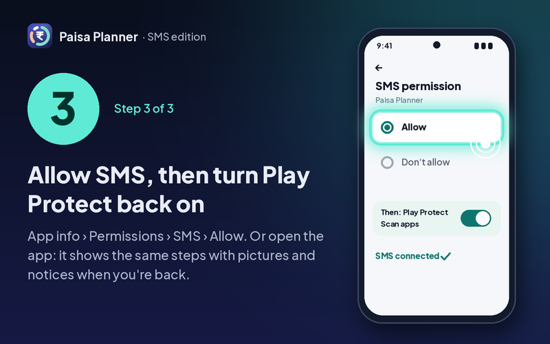

---

## Screenshots

<table>
  <tr>
    <td>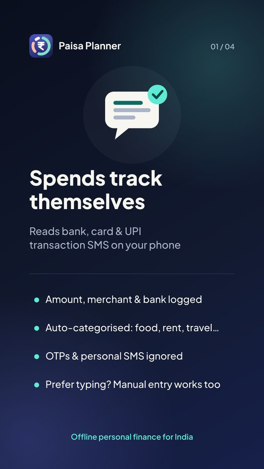</td>
    <td>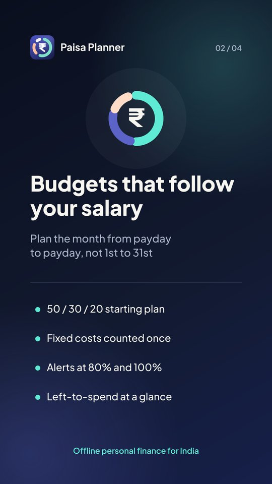</td>
    <td></td>
    <td>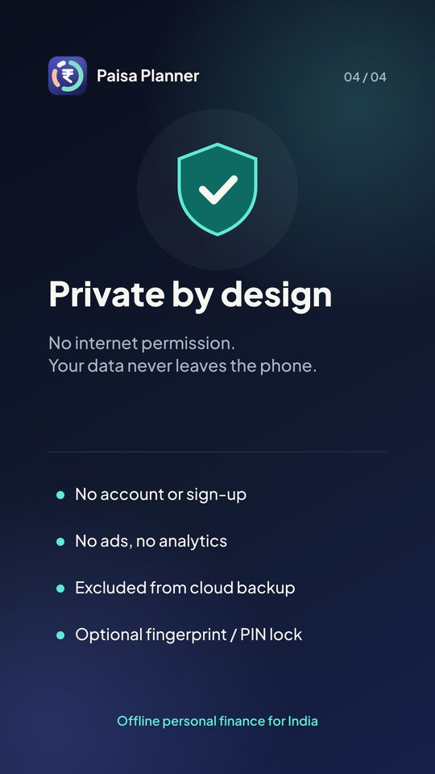</td>
  </tr>
</table>

## What it does

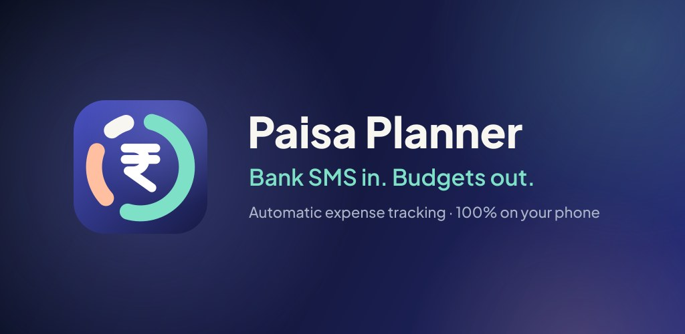

- **Add a spend in seconds.** Type or say "200 vegetables", scan a bill, or paste a bank message. Hindi and Hinglish work too ("do sau sabzi").
- **Bank SMS in 2 taps, no SMS permission.** Long-press a bank SMS › ⋮ › **Add to Paisa Planner**, or Share it to the app, or copy and paste it. You check it before anything is saved.
- **Better receipt scan.** It finds the Grand Total on your bill and fills the form, right on your phone.
- **Automatic SMS tracking, if you want it,** in the separate SMS edition (see above). OTPs and personal messages are ignored.
- **Budgets that follow your salary day,** with a simple 50/30/20 starting plan and a gentle warning before you overspend.
- **Your own categories.** Add or edit categories in each section (Needs, Wants, Savings & investments), with your own name and emoji.
- **Save on purpose:** savings goals, a 48-hour "park it" wishlist for impulse buys, and reminders for bills and subscriptions.
- **Cards, loans and friends:** credit card due dates, loans and EMIs, split bills, and money you lent or borrowed.
- **See the big picture:** net worth, a tax helper (old vs new regime) and a monthly "Money Story" recap.
- **Keep it safe:** fingerprint or PIN lock, encrypted backup, and CSV or PDF export. A gentle monthly reminder helps you keep a backup in Google Drive or Files.
- **Light, Dark or System theme,** picked right in setup (change it any time in Settings).
- **English and Hindi.**
- **Feedback and updates in Settings:** a short feedback form, and **Check for updates** opens the latest version.

## Privacy

Everything stays on your phone. No account, no sign-up, no ads, no internet permission. The clipboard is read only when you tap **Paste from clipboard**. Privacy policy: https://docs.google.com/document/d/1iUYxkjJ_4VVWXWgGWBGLeUpQRzRbcW5OXN6XJLUKoT0/edit?usp=sharing

## Feedback and support

Found a problem or want a feature? [Share it in this short form](https://docs.google.com/forms/d/e/1FAIpQLSfLpaZU3By-WU9KWcMSKTAuoew2hy2qFcAo1fQ6s-UV0EHFrQ/viewform) (no sign-in needed).

Support: sauravsahbrj@gmail.com

<details>
<summary><b>For developers</b></summary>

<br>

- Native Android app: Kotlin, Jetpack Compose (Material 3), Room, WorkManager, on-device ML Kit text recognition for receipts.
- Package `com.saurav.paisaplanner` · version 3.6.0 (versionCode 16) · minSdk 26 (Android 8.0) · targetSdk 36.
- Two product flavors with the same applicationId, versionCode and signing key, so they install over each other and keep the data:
  - **standard** (`PaisaPlanner-v3.6.0-arm64.apk`, `PaisaPlanner-v3.6.0.apk`): no SMS permission, no notification listener, no accessibility service. Bank messages come in through `ACTION_PROCESS_TEXT` ("Add to Paisa Planner" in the text-selection menu), `ACTION_SEND` and the in-app paste screen.
  - **sms** (`PaisaPlanner-v3.6.0-SMS-edition-arm64.apk`, `PaisaPlanner-v3.6.0-SMS-edition.apk`, and the Play AAB): adds `READ_SMS`, `RECEIVE_SMS` and the SMS receiver.
- Why two: Google Play Protect's enhanced fraud protection in India blocks internet-sideloaded apps that declare `RECEIVE_SMS`, `READ_SMS`, a notification listener or accessibility ([Google's developer guidance](https://developers.google.com/android/play-protect/warning-dev-guidance)), and Android 13+ restricted settings deny the SMS permission to sideloaded apps until the user allows it.
- Permissions (standard): `POST_NOTIFICATIONS`, `USE_BIOMETRIC`, `USE_FINGERPRINT`, `WAKE_LOCK`, `RECEIVE_BOOT_COMPLETED`, `com.saurav.paisaplanner.DYNAMIC_RECEIVER_NOT_EXPORTED_PERMISSION`. No `INTERNET`.
- Permissions (SMS edition): `READ_SMS`, `RECEIVE_SMS`, `POST_NOTIFICATIONS`, `USE_BIOMETRIC`, `USE_FINGERPRINT`, `WAKE_LOCK`, `RECEIVE_BOOT_COMPLETED`, `com.saurav.paisaplanner.DYNAMIC_RECEIVER_NOT_EXPORTED_PERMISSION`. No `INTERNET`.
- `arm64` files are 64-bit ARM only (smaller); the others are universal. Older versions stay in the repo and on the releases page.
- Signing certificate SHA-256: `70e49d10ad885f31444a9886646d52ea3b98a15f828bd39a795b135bcdbfeabc` (the same key since v2.0, so every update installs over the last one).

SHA-256 of the files:

```
a732127942f9dd2bc2f8d57fd7140578313da30bfd84e31d32d80639e145d807  PaisaPlanner-v3.6.0-arm64.apk
8292baccb803dc4fa57f02c0692c776985dfd8d6728c2c8945caf9d893dd748b  PaisaPlanner-v3.6.0.apk
4f2ea28930b2d772d4728106351d7b6a3807602299576a3c28ace8ab33635893  PaisaPlanner-v3.6.0-SMS-edition-arm64.apk
770c079b664c0f9059c3ec78c87f98a7df7fd6316cfe2a3402cdbbc34a11f26a  PaisaPlanner-v3.6.0-SMS-edition.apk
```

Check a download with `apksigner verify --print-certs PaisaPlanner-v3.6.0-arm64.apk` (Android build-tools).

</details>
